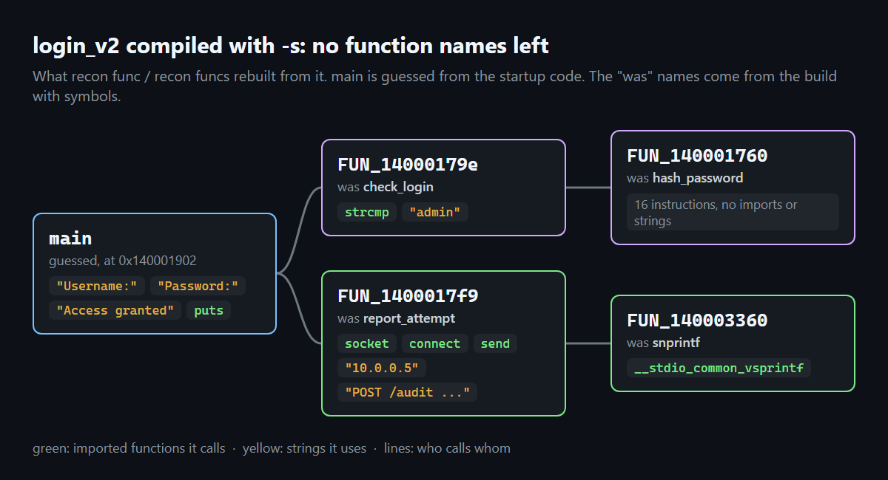
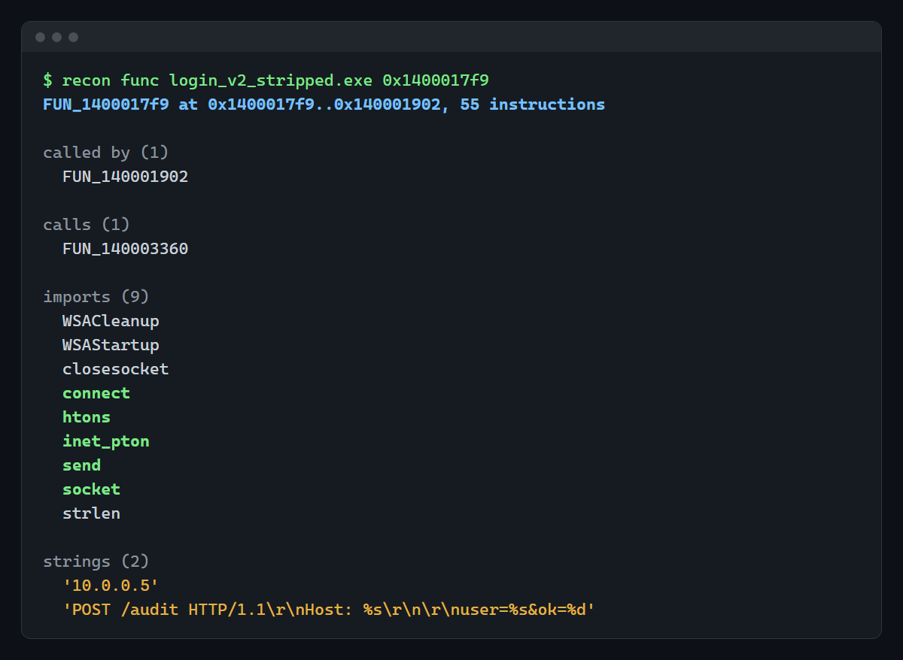
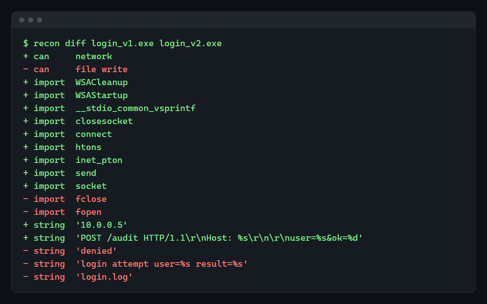
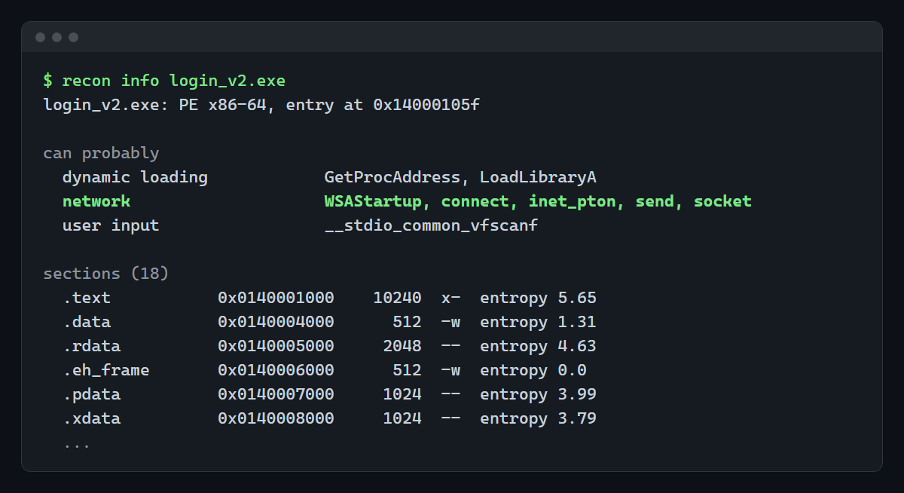

# RECON

Point it at an unknown binary and it tries to work out what the program does, from the evidence inside the file. It never runs the program.



That's a small login program compiled with `-s`, so every function name is gone. RECON still finds the functions, who calls whom, and which system APIs and strings each one uses. I only know the "was" names because I compared with the build that has symbols.

## Why

I wanted to understand how tools like Ghidra figure out where the functions are and what calls what, so I'm writing those pieces myself. Later I want to put an AI agent on top, one that answers things like "where is the login checked?" by looking through what the analysis found, without reading the whole binary.

It's also a good excuse to finally learn PE/ELF and x86-64 properly.

## Try it

```bash
pip install -e .
recon info program.exe       # format, what it can probably do, packing hints, sections, imports, exports
recon strings program.exe    # printable strings with their address
recon funcs program.exe      # functions found in the code, with what they call
recon func program.exe main  # one function: who calls it, what it calls, imports, strings
recon diff old.exe new.exe   # what changed between two versions
```

Add `--json` before the command (`recon --json funcs program.exe`) to get JSON instead of text. Works on PE (Windows) and ELF (Linux) files, read with [LIEF](https://lief.re) and disassembled with [Capstone](https://www.capstone-engine.org).

`samples/` has the two login programs I use to test it. Version 2 stops writing a local log file and reports each login attempt to a server instead, and that's the change all the examples below are about.

## Taking apart a stripped binary



`recon funcs` starts from what the file already gives away (entry point, exports, symbols and the x64 exception table, which lists where each function starts and ends) and then follows every direct `call` until no new functions show up. For each one it keeps the functions it calls, the imported APIs it calls and the data it points at, so a string like `"10.0.0.5"` gets tied to the code that uses it.

So even with no names, `FUN_1400017f9` is clearly the one talking to the server. Its only caller prints `"Username:"`, so that one is `main`.

MinGW took me a while. It never calls `connect` directly, it calls a tiny stub that only does `jmp [import table]`, and for a while every stub showed up as a function of its own with the network calls spread across them. A call to one of those stubs now counts as a call to the import (the PLT on Linux works the same way).

I also tried it on Windows' notepad.exe. It finds 423 functions in about 2 seconds, and this is one of them:

```
$ recon func notepad.exe FUN_14000ca10
FUN_14000ca10 at 0x14000ca10..0x14000cb73, 85 instructions

called by (2)
  FUN_14000d078
  FUN_14000d54c

calls (2)
  FUN_1400019f0
  FUN_140023ae0

imports (4)
  CloseHandle
  CreateFileW
  IsTextUnicode
  ReadFile
```

Opens a file, reads it and checks whether the text is Unicode. Pretty sure that's part of opening a document.

## Comparing two versions



`recon diff` compares imports, strings and what each version can probably do. Without reading a single instruction you can tell the file writing went away and network code came in, with the server address and what gets sent.

After that it lists the functions that changed:

```
+ func    report_attempt, 55 instructions
            + calls snprintf, WSACleanup, WSAStartup, closesocket, connect, htons, inet_pton, send, socket, strlen
            + uses '10.0.0.5', 'POST /audit HTTP/1.1\r\nHost: %s\r\n\r\nuser=%s&ok=%d'
+ func    snprintf, 30 instructions
            + calls __local_stdio_printf_options, __stdio_common_vsprintf
- func    log_attempt, 24 instructions
            - calls fprintf, fclose, fopen
            - uses 'denied', 'login attempt user=%s result=%s', 'login.log'
~ func    check_login, 16 -> 23 instructions
~ func    main, 39 instructions
            + calls report_attempt
            - calls log_attempt
```

Which matches what I did in v2. I swapped the log function for one that reports to the server, `main` calls the new one, and `check_login` now locks the account after three failures. `hash_password` stayed the same, so it isn't listed.

To pair old and new functions it tries the name first, then identical code (same instructions, even at another address), and last the imports and strings they share. So it works on stripped builds too, and comparing the two `-s` versions gives the same five changes with `FUN_` names. The last step is a guess. A function that changed a lot and uses nothing distinctive shows up as one removed and one added.

## What a program can probably do



"Can probably" groups the imports: `socket`/`connect`/`send` is network, `fopen`/`WriteFile` is writing files, `CreateProcess` is starting other programs, and so on. Importing something doesn't mean the program calls it, so each line shows the imports behind it. Every MinGW build imports `LoadLibraryA` and `GetProcAddress` for its startup code, which is why "dynamic loading" shows up even in the samples. Now that I know which function calls what, I want to count only the imports the program's own code uses.

`info` also warns when a program looks packed (UPX and similar section names, code with entropy above 7.2, code that is also writable). Packed programs keep the real code compressed until they run, so an empty result there means little.

## Where it's at

Working so far: loading PE/ELF, strings, imports and exports, capabilities, packing hints, functions and the call graph, and the diff down to the function level.

What I want to do next, more or less in this order: control flow inside a function, cross-references (who uses this string or this global), 32-bit x86, and then the AI part. Running samples in a sandbox to see what they really do is further away.

## Known limits

- Everything is static. A program that downloads or unpacks its code at runtime shows only its loader.
- Capabilities come from a small table of known functions. Anything called through `GetProcAddress`, or through syscalls directly, isn't seen yet.
- Strings are plain ASCII and UTF-16 runs of 4 or more visible characters. Encoded or built-at-runtime strings don't show up.
- A function ends where the exception table says, or at the next known start when there's no table (ELF). That works on compiler output, but hand-written or obfuscated code can fool it.
- Calls through a register (`call rax`, virtual methods, callbacks) are only counted, not followed.
- The disassembly is x86-64 only. ARM files load, but nothing past the headers has been checked on them.

I've run it on Windows' own binaries (notepad, kernel32, ntdll, Edge) and on broken files. It reads MinGW's long section names (`/4`, `/29`... point to the real name in a table at the end of the file), shows no entry point for a DLL that has none, and warns when a file is cut short instead of loading it as an empty program.

## Code

`loader.py` turns what LIEF reads into one small model for PE and ELF, and everything else works on that. `disasm.py` finds the functions and builds the call graph (NetworkX), `diff.py` and `funcdiff.py` compare two binaries, and `cli.py` is the `recon` command.

## Tests

```bash
pip install -e .[dev]
pytest
```

The tests build the samples with whatever `gcc` is on the machine, so on Windows they check PE files and on Linux ELF files. CI runs both.

MIT license.
